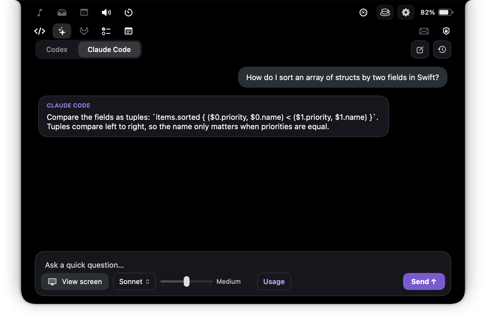
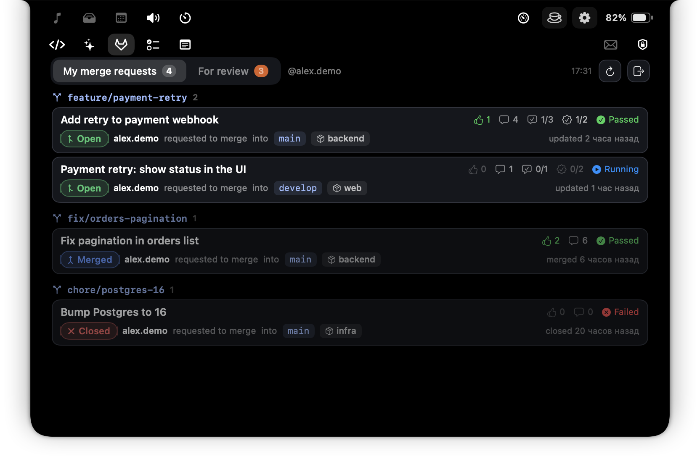
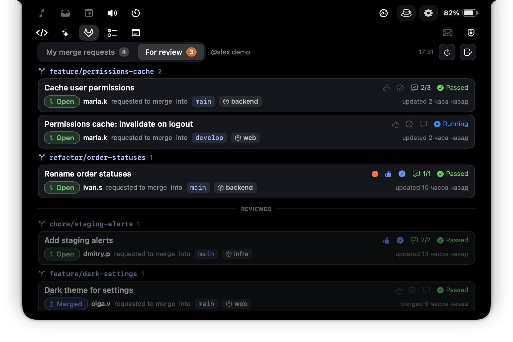
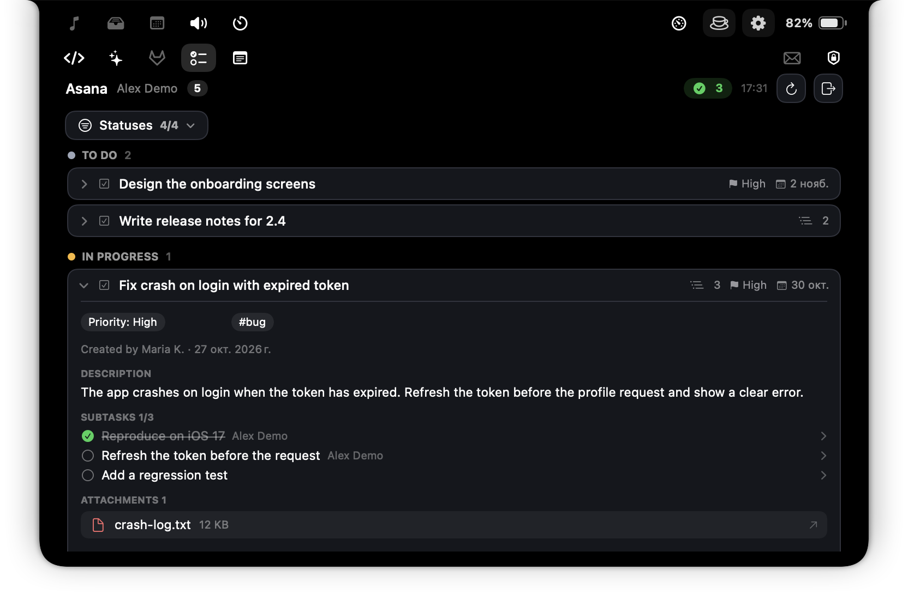
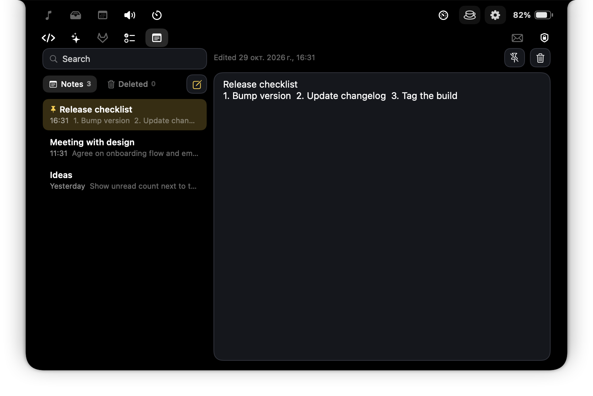

# OmniMac Custom

Моя доработанная версия открытого macOS-приложения [OmniMac](https://github.com/BySergiMM/OmniMac) (автор оригинала — Sergi, BySergiMM, лицензия MIT). Это «Dynamic Island» в области выреза экрана (работает и на Mac без выреза), в который я добавил рабочие вкладки: AI-чат, GitLab, Asana, заметки, а также быстрые кнопки почты, VPN и VS Code.

Все токены хранятся только в **связке ключей macOS** на вашем компьютере. Приложение ничего не отправляет на сторонние серверы, кроме обращений к самим сервисам (GitLab, Asana, Codex/Claude).

Оригинальное описание всех утилит OmniMac — в [README.original.md](README.original.md).

## Что добавлено

| Вкладка | Что делает | Права |
|---|---|---|
| **AI** | Быстрый чат с Codex и Claude Code: выбор модели и уровня рассуждения, история чатов, лимиты (сессия 5 ч и неделя), скриншоты (до 10) | Только отправка вопросов, без доступа к файлам и командам |
| **GitLab** | «Мои merge requests» и «На ревью» за последние 3 дня, группировка по ветке и репозиторию, лайки, аппрувы, треды, пайплайны | Только чтение (`read_api`) |
| **Asana** | Мои задачи по статусам, фильтр, подзадачи, связи, вложения, комментарии, счётчик закрытых сегодня | Чтение + комментарии и вложения |
| **Заметки** | Собственные заметки внутри OmniMac (не Apple Notes): поиск, закрепление, удалённые 30 дней | Локальный файл |
| **VS Code** | Открытые окна VS Code со всех рабочих столов, быстрое переключение | Универсальный доступ |
| **Почта / VPN** | Кнопка Outlook с числом непрочитанных; подключение и отключение FortiClient | Универсальный доступ |

## Требования

- macOS 14.2 или новее.
- Инструменты разработчика: `xcode-select --install` (нужен Swift 5.9+).
- Для вкладок по желанию: Codex, Claude Code, аккаунты GitLab и Asana, Outlook, FortiClient, VS Code. Каждая вкладка работает независимо, ненужные просто не подключайте.

## Установка

Готового установщика у этой версии нет, приложение собирается у вас на Mac.

```bash
git clone https://github.com/vinogradovkk-byte/omnimac-custom.git
cd omnimac-custom
git checkout dev
./build.sh run
```

Сборка создаёт `dist/OmniMac.app` и запускает его. Положите приложение в `/Applications`, если хотите, чтобы оно было всегда под рукой. Приложение подписано локально (ad-hoc), и поскольку вы собираете его сами, Gatekeeper не блокирует запуск.

После изменений в коде: `swift build`, затем `zsh scripts/dev/quickbuild.sh` и перезапуск (`pkill -x OmniMac; open dist/OmniMac.app`). Быстрая сборка заменяет бинарник, поэтому право «Универсальный доступ» не слетает.

## Первый запуск и разрешения

Откройте Системные настройки → Конфиденциальность и безопасность и выдайте OmniMac:

1. **Универсальный доступ**: нужен вкладке VS Code, почте и VPN. Без него эти части не работают.
2. **Запись экрана**: нужна только кнопке «Видеть экран» в AI-чате.

Иконки вкладок появляются в выпадающей панели при наведении на вырез экрана. Вторая строка иконок содержит AI, GitLab, Asana и заметки.

При первом обращении к токену macOS спросит пароль связки ключей. Нажмите «Разрешать всегда». После пересборки приложения macOS может спросить ещё раз, это нормально для локальной подписи.

## Подключение вкладок

Скриншоты ниже сделаны самим приложением на вымышленных данных (`OmniMac --snapshots`): реальных аккаунтов и задач на них нет.

### AI: Codex и Claude Code

<p align="center"></p>

Быстрый чат для коротких вопросов без переключения в другие окна. Вкладка запускает официальные клиенты Codex и Claude Code на вашем Mac; своих ключей и серверов у приложения нет.

**Подключение**
1. Установите клиент, который хотите использовать. Приложение ищет **Codex** в `/opt/homebrew/bin/codex`, `/usr/local/bin/codex`, `~/.local/bin/codex` и в расширении VS Code `openai.chatgpt-*`. **Claude Code** (`claude`) ищется в `/opt/homebrew/bin`, `/usr/local/bin`, `~/.local/bin` и в расширении VS Code `anthropic.claude-code-*`.
2. Откройте вкладку AI (иконка с искрами). Если клиент не найден, вкладка скажет об этом; если не выполнен вход, покажет кнопку «Войти» (откроет вход самого клиента; Claude Code можно войти и командой `claude auth login`).
3. Переключайтесь между **Codex** и **Claude Code** сверху слева.

**Как пользоваться**
- Внизу введите вопрос и нажмите «Send» (Enter отправляет, Shift+Enter переносит строку).
- **Модель**: выпадающий список рядом с кнопкой «View screen». Список берётся у самого клиента, у каждой модели есть описание.
- **Уровень рассуждения**: ползунок справа от модели (от Low до Max, набор зависит от модели).
- **Usage**: кнопка показывает, сколько осталось лимита за сессию (5 часов) и за неделю.
- **View screen**: прикрепляет снимок экрана к вопросу (до 10 штук; миниатюры над полем ввода, у каждой есть крестик). Снимок можно открыть кликом в сообщении. Нужно разрешение «Запись экрана».
- **Новый чат** и **история** (кнопки справа сверху): продолжают прошлые разговоры из истории клиента.
- Чат работает как «безопасный быстрый ответ»: инструменты, запуск команд и доступ к файлам отключены, ответ строится только по вашему вопросу и снимкам.

### GitLab (только чтение)

<p align="center"></p>

Видно ваши МР и МР на ревью за последние 3 дня, без захода в браузер. Приложение только читает данные и ничего в GitLab не меняет.

**Подключение**
1. Откройте GitLab → ваш профиль → Preferences → **Access Tokens** (кнопка «Создать токен» во вкладке откроет эту страницу на нужном сервере).
2. Создайте личный токен **только со scope `read_api`**, других прав не давайте. Срок действия задайте на ваше усмотрение.
3. Во вкладке GitLab (иконка лисы) введите адрес сервера (по умолчанию `https://gitlab.com`; для своего сервера укажите его адрес, например `https://gitlab.company.com`) и вставьте токен. Нажмите «Подключить».
4. Токен сохранится в связке ключей. При первом чтении macOS спросит пароль связки: нажмите «Разрешать всегда».

**«My merge requests»**
- Ваши МР: открытые, смерженные и закрытые за последние 3 дня (по дате слияния или закрытия).
- МР **сгруппированы по ветке-источнику**: если из одной ветки идут МР в разные репозитории, они лежат вместе. На каждом МР виден репозиторий (иконка коробки), целевая ветка, статус (Open, Merged, Closed), автор и время.
- Справа показаны лайки, апрувы (сколько получено из требуемых), комментарии и решённые обсуждения (например `1/3`), статус пайплайна (Passed, Running, Failed).
- Ветка остаётся наверху, пока в ней есть хотя бы один открытый МР. Вниз она уходит, только когда все её МР смержены или закрыты; внутри ветки открытые идут выше завершённых.

<p align="center"></p>

**«For review»** (переключатель рядом, счётчик показывает, сколько веток ждут вас)
- МР, где вас назначили ревьюером: открытые, а также смерженные и закрытые за 3 дня.
- Для каждого МР показаны **только ваши действия**: ваш лайк, ваш апрув, ваши комментарии и сколько из них решено (`2/3`).
- МР считается проверенным вами, когда на нём стоят **и ваш лайк, и ваш апрув**, и после этого не появилось новых коммитов. Смерженные и закрытые считаются завершёнными сразу.
- Оранжевый **«!»** означает: после вашей проверки появился новый коммит, нужна повторная проверка.
- Ветка уходит под разделитель **REVIEWED** (притемнена), только когда все её МР завершены для вас. Пока хоть один МР без лайка и апрува, ветка наверху.
- Клик по МР открывает его в браузере.

### Asana

<p align="center"></p>

Ваши незавершённые задачи по статусам (колонкам доски) со всех рабочих пространств, с описанием, подзадачами и комментариями прямо в приложении.

**Подключение**
1. Откройте https://app.asana.com/0/my-apps → **Create new token** (Personal access token). Дайте имя, например OmniMac, и скопируйте токен (он показывается один раз).
2. Во вкладке Asana (иконка чек-листа) вставьте токен и нажмите «Подключить». Токен хранится в связке ключей macOS.

**Как пользоваться**
- Задачи сгруппированы по статусам в порядке колонок вашей доски. Фильтр **Statuses** открывает список с галочками: можно скрыть лишние колонки, есть «Выбрать все» и «Снять все».
- Справа сверху **зелёный счётчик с галочкой** показывает, сколько ваших задач вы закрыли сегодня. Рядом время последнего обновления, кнопка обновления и кнопка отключения.
- Строка раскрывается: теги и поля (например приоритет), автор и дата создания, описание, подзадачи (с отметкой выполнено), вложения, комментарии.
- Подзадачу, родительскую задачу и связанные (кто блокирует эту задачу и кого блокирует она) можно открыть внутри OmniMac; кнопка «К списку» возвращает назад.
- Вложения показываются списком, картинки с миниатюрой; клик открывает файл.
- **Комментарии**: поле внизу страницы задачи. Enter отправляет, Shift+Enter переносит строку. Файлы добавляются кнопкой скрепки, перетаскиванием или вставкой ⌘V (файлы и скриншоты из буфера). Над полем показаны миниатюры с крестиками, до 100 МБ на файл.
- Приложение пишет в Asana **только комментарии и вложения**. Статусы, описания и исполнителей оно не меняет.

### Заметки

<p align="center"></p>

Собственные заметки OmniMac, не Apple Notes: ничего никуда не синхронизируется.

- Слева список: сверху закреплённые, дальше по дате изменения. Поиск ищет по всему тексту.
- Кнопка с карандашом создаёт заметку. Первая строка текста становится заголовком, вторая показывается в превью.
- Справа редактор. Закрепить и удалить заметку можно кнопками справа сверху.
- Удалённые заметки лежат во вкладке **Deleted** 30 дней и только потом исчезают; оттуда их можно восстановить.
- Данные хранятся в `~/Library/Application Support/OmniMac/notes.json`. Если файл повреждён, приложение переименует его и начнёт новый, ничего не стирая.

### Outlook и FortiClient

В верхней строке панели справа две кнопки.

**Outlook (конверт)**
- Клик открывает приложение Outlook, а если его нет, веб-версию в браузере.
- Красный значок показывает число непрочитанных. Оно читается из бокового списка нового Outlook, поэтому нужен «Универсальный доступ», и Outlook должен быть запущен.

**VPN (замок)**
1. Установите FortiClient и один раз настройте в нём подключение (адрес сервера задаётся в самом FortiClient).
2. Откройте панель VPN: там статус (Подключён, Подключается, Отключён).
3. Введите имя пользователя и пароль, при желании отметьте «Сохранить пароль в связке ключей macOS» и нажмите «Подключиться». OmniMac подставит данные в окно FortiClient и нажмёт его кнопку. Если нужен двухфакторный код, введите его в окне FortiClient.
4. Кнопка «Отключить» разрывает соединение. «Забыть сохранённый пароль» удаляет пароль из связки.
5. Нужен «Универсальный доступ»: управление окном FortiClient идёт через него.

### VS Code

Вкладка со значком `</>` показывает **все открытые окна VS Code со всех рабочих столов**, в том числе и тогда, когда на текущем столе VS Code нет.

- Клик по окну переключает на него (и на нужный рабочий стол).
- Кнопка нового окна открывает пустое окно VS Code; если VS Code не запущен, запускает его.
- Нужны «Универсальный доступ» и запущенный VS Code. Имена окон берутся из меню «Окно» самого VS Code.

## Безопасность

- GitLab: токен только `read_api`, приложение выполняет только GET-запросы.
- Asana: токен личный, записи ограничены комментариями и вложениями.
- Все токены лежат в связке ключей macOS; пароль VPN сохраняется только если вы отметите это.
- Вкладки не требуют серверов разработчика: приложение общается напрямую с GitLab, Asana и клиентами Codex и Claude.
- Не публикуйте токены и не отправляйте их в чаты. Если токен засветился, отзовите его в настройках сервиса.

## Разработка

```bash
swift build                      # компиляция
swift test                       # тесты (нужен полный Xcode с XCTest)
zsh scripts/dev/quickbuild.sh    # быстрая сборка для arm64
./build.sh run                   # полная сборка и запуск
```

Код и комментарии в проекте на испанском (унаследовано от оригинала), видимые тексты задаются через `L("русский", "English")`.

## Лицензия

MIT. Оригинальный код © 2026 Sergi (BySergiMM). Мои доработки распространяются на тех же условиях; файл [LICENSE](LICENSE) нужно сохранять.
